<div align="center">

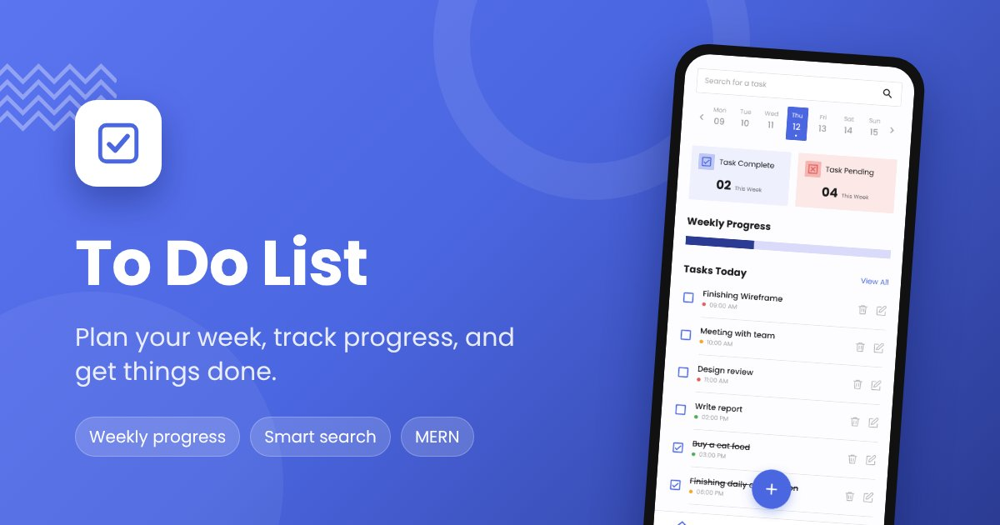

# To-Do List App (MERN)

**Plan your week, track progress, and get things done.**

[](https://todo-list-mern01.netlify.app/)
[](https://todo-list-api-1n6q.onrender.com/api/health)


</div>

A mobile-first To-Do List app built with **MongoDB, Express, React and Node.js**.
Users **sign up / sign in**, then create, view, edit, delete, search and complete **their own** tasks. Tasks are grouped by week (Monday to Sunday), and each week shows how many tasks are open and how many are completed.

The UI follows the Figma design (Onboarding, Home, Add New Task, Search).

| | Link |
|---|---|
| 🌐 **Live app** | https://todo-list-mern01.netlify.app |
| ⚙️ **API** | https://todo-list-api-1n6q.onrender.com |
| 💚 **API health** | https://todo-list-api-1n6q.onrender.com/api/health |
| 🎨 **Figma** | [To-Do List Mobile app](https://www.figma.com/design/mz2PJoTwa5DxYrdrFPem3f/To-Do-List-Mobile-app?node-id=0-1) |
| 📚 **More detail** | [`server/README.md`](server/README.md) · [`client/README.md`](client/README.md) |

> **Try it:** open the live app. The Sign In screen fills in the test account (`test@todo.app` / `Test@1234`), so you can tap **Sign In** at once.
> The API is on Render's free plan, so the **first** request after a quiet period can take up to about 50 seconds. The startup screen shows this and tries again by itself.

<p align="center">
  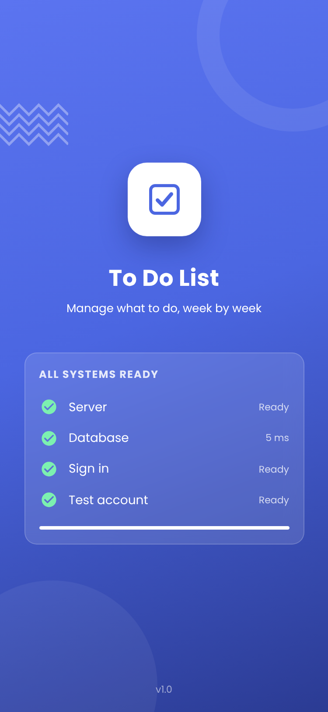
  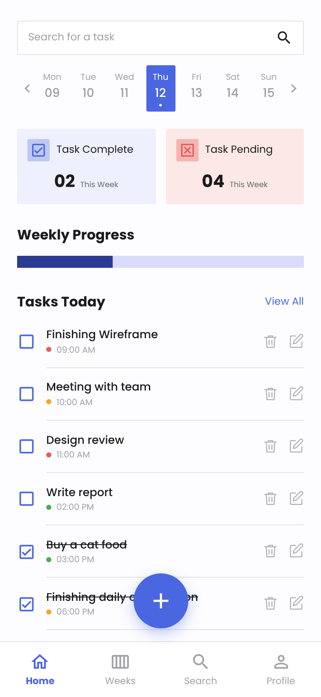
  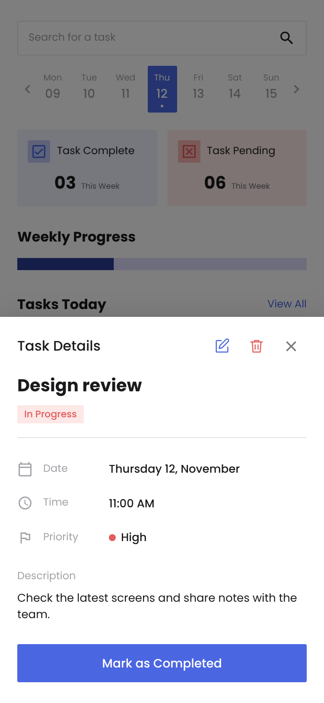
  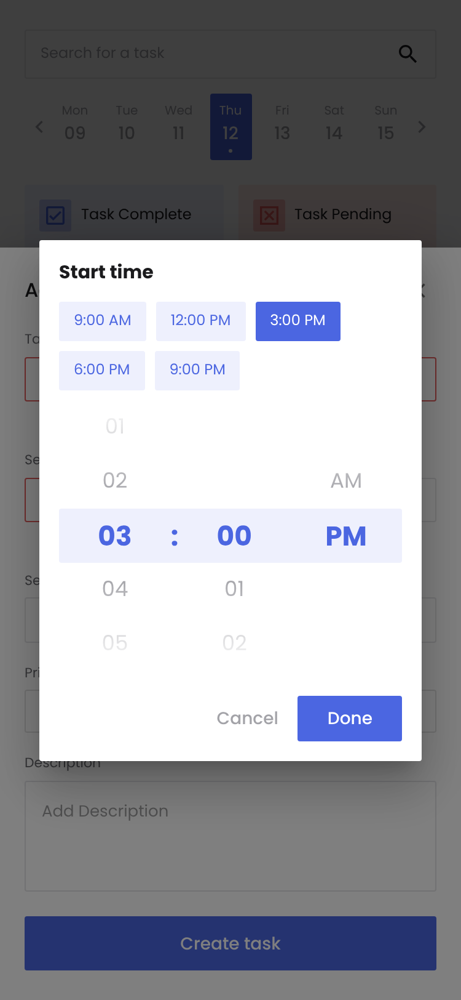
  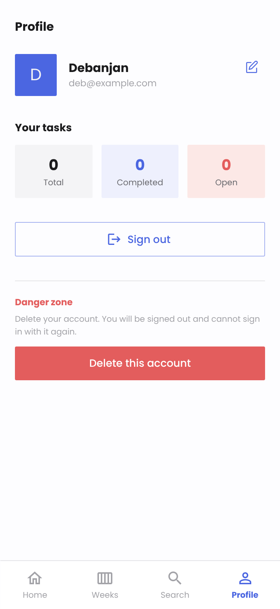
</p>

## Architecture

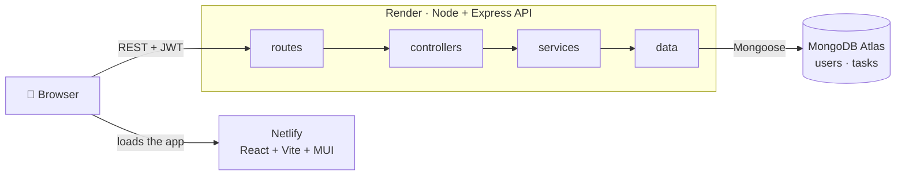

---

## 1. Features

| Requirement (from the assignment) | How it works in the app |
|---|---|
| Accounts (extra) | **Sign Up** (name, email, password) and **Sign In**. Private pages need a sign-in. Each user sees only their own tasks. **Sign out** is on the Profile page. |
| Create a task (title*, description, date & time*, priority) | `+` button opens the **Add New Task** sheet. Title, start time and date are required. |
| View a task | Tap a task to open the **Task Details** drawer: status, date, time, priority, description, **Edit** and **Delete** icons, and a Mark Completed / In Progress button. |
| Edit a task | Pencil icon on the row or in Task Details. The sheet opens with the saved values. |
| Delete a task | Trash icon (row or Task Details), **swipe left** and tap **Delete**, or "Delete task" in the edit sheet. A confirm dialog opens first. |
| Search tasks by keyword | Tap the search bar. The server searches the **title and description** (not case-sensitive). Results can be viewed, edited and deleted. |
| Tasks grouped by week (Mon–Sun) | **View All** shows one card per week. |
| Week card shows open and completed counts | Each card shows **Open** and **Completed**. Tap the card to expand it. |
| Mark a task as Completed / In Progress | Checkbox on the row, or the button in Task Details. Counts and the progress bar update at once. |
| Fully responsive mobile UI | At phone width the app fills the screen. On a large screen it shows in the middle, at phone width. |

Extra features:
- **Shareable link:** favicon, app icons, a description and a link-preview image (Open Graph and X/Twitter tags), so the link shows a card in WhatsApp, Slack, LinkedIn and X.
- **Startup screen:** at app start, a loading screen checks `GET /api/health` (server, MongoDB ping, sign in, test account) and shows each check live. If something is down, it shows why and tries again every 5 s. It runs **once per browser session** (saved in `sessionStorage`): reloads in the same tab skip it.
- **Test account:** on every server start, the server makes sure **one** test user exists. The Sign In screen fills it in.
- **"Something went wrong" page:** if a screen crashes, an error boundary shows a friendly page with **Try again** and **Go to Home**.
- **Auth:** JWT login, bcrypt password hashes, session kept after reload, automatic sign out when the token expires.
- **Bottom navigation** (Home · Weeks · Search · Profile) for signed-in users. The `+` button floats above it.
- **Profile page:** name, email, task numbers, Sign out (with confirm), **Edit Profile** drawer (name editable, email disabled), and **Delete this account** (confirm → soft delete).
- **Connect to Claude (MCP):** an MCP server at `POST /mcp` lets Claude (Claude Code, Claude Desktop or any MCP client) list, search, create, update, complete and delete your tasks, and give a weekly summary. **One-click OAuth:** add the URL as a custom connector, click Connect, sign in and tap **Allow**. Clients without OAuth can use a **personal access token** (shown one time). Revoke access at any time on the Profile page. See [AI access (MCP)](#ai-access-mcp).
- **Week strip** with arrows to move to the previous or next week.
- **Task Complete / Task Pending** cards and a **Weekly Progress** bar for the selected week.
- **Priority dot:** green = Low, orange = Medium, red = High.
- **Modern pickers:** a scroll-wheel time picker and a calendar, each with quick chips (9 AM, Tomorrow, …).
- **Form checks:** required fields, and the end time must be after the start time. An error clears as soon as the field is fixed.
- **Loading states:** skeletons while tasks load. Spinners on every button that calls the API.
- **Confirm before delete** on every delete action.
- **Soft delete:** tasks are never removed from the database.
- **Fixed headers:** only the list scrolls on Home, All Weeks and Search.
- **Error messages:** if an API call fails, a red message shows at the bottom.

---

## 2. Tech stack

| Layer | Technology | Why |
|---|---|---|
| Frontend | React 18 + Vite | Fast dev server, simple setup |
| UI library | MUI (Material UI) + MUI Icons | Ready components: Drawer, Dialog, Checkbox, Accordion, Fab, Skeleton |
| Date & time | MUI X `DateCalendar` + dayjs + custom wheel picker | Calendar and iOS-style time wheels |
| Routing | React Router 6 | `routes/index.jsx` → `PublicRoutes` (`/`, `/signin`, `/signup`) or `PrivateRoutes` (`/home`, `/weeks`, `/search`, `/profile`) |
| Auth | JWT (`jsonwebtoken`) + `bcryptjs` | Stateless login token, hashed passwords |
| State | React Context | One shared task list for all pages, with no extra library |
| Backend | Node.js + Express | REST API with **controller → service → data** layers |
| Database | MongoDB + Mongoose | Schema, validation, search, soft delete |
| Package manager | pnpm | Fast installs (`pnpm-lock.yaml` in each app) |
| Unit tests | Vitest (+ React Testing Library, jsdom on the client) | Jest-style API, works natively with ES modules and Vite |
| Hosting | Netlify (UI), Render (API), MongoDB Atlas (DB) | Free tiers |

---

## 3. Screens and user flow

```
App start ─▶ Startup screen (GET /api/health) ─▶ all OK ─▶ (saved sign-in? ─▶ Home : Onboarding)
                       └─ something down ─▶ reason + "Try again" (auto every 5 s)
Any crash ─▶ "Something went wrong" (Try again / Go to Home)

SIGNED OUT (PublicRoutes)                 SIGNED IN (PrivateRoutes + bottom nav: Home · Weeks · Search · Profile)
Onboarding ─Get Started─▶ Sign In ◀──▶ Sign Up
                             │ success
                             ▼
                           Home ──search bar──▶ Search
                             ├──View All──▶ All Weeks (expandable week cards)
                             ├──  +  ─────▶ Add New Task sheet ──▶ time / date picker dialogs
                             ├── task row: tap = Task Details · ☐ status · 🗑 delete · ✎ edit · swipe left = Delete
                             └── Profile ──Sign out (confirm)──▶ Sign In
```

| Screen | What it shows |
|---|---|
| **Startup screen** | Gradient, animated logo, live rows: Server · Database (ping ms) · Sign in · Test account, progress bar, Try again |
| **Something went wrong** | Drawing, message, **Try again**, **Go to Home**, hidden error details |
| **Onboarding** | Blue area with a zig-zag pattern, "Manage What To Do", **Get Started** (→ Sign In) |
| **Sign In / Sign Up** | Blue band, email + password (+ name and confirm on Sign Up), show/hide password, field errors, server error message. Sign In fills in the test account. |
| **Home** | Search bar, week strip, Complete / Pending cards, Weekly Progress, tasks of the selected day, `+` |
| **Task Details** | Bottom drawer: title, status badge, date, time, priority, description, Edit / Delete, Mark Completed |
| **Add / Edit Task** | Bottom sheet: title, Start / Ends, date, priority, description, **Create task** |
| **Time / Date picker** | Centered dialog: quick chips + wheels (time) or calendar (date), **Cancel / Done** |
| **All Weeks** | One card per week with Open / Completed counts. The current week opens first. |
| **Search** | Back arrow, search box, matching tasks |
| **Profile** | Avatar, name, email, edit icon, Total / Completed / Open numbers, **Sign out**, Danger zone: **Delete this account** |
| **Edit Profile** | Bottom drawer: Name (editable, 50 max), Email (disabled, "cannot be changed"), **Save changes** |
| **Bottom nav** | Home · Weeks · Search · Profile (signed-in pages only) |

### Screenshots (375px phone width)

| Startup: checking | Startup: all ready | Startup: database down | Something went wrong |
|---|---|---|---|
| 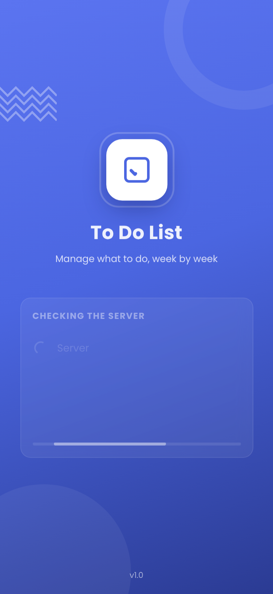 |  | 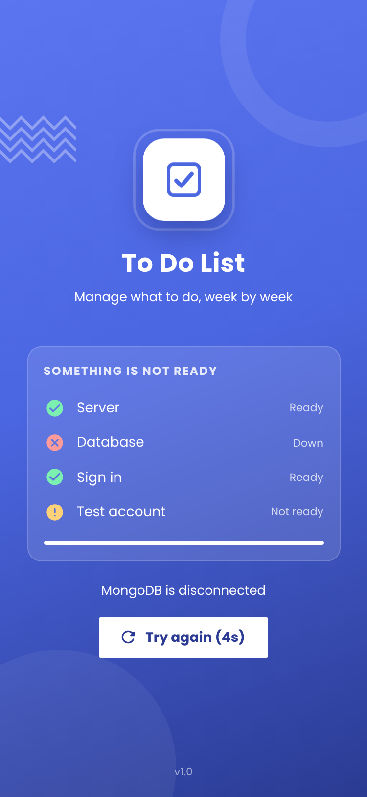 | 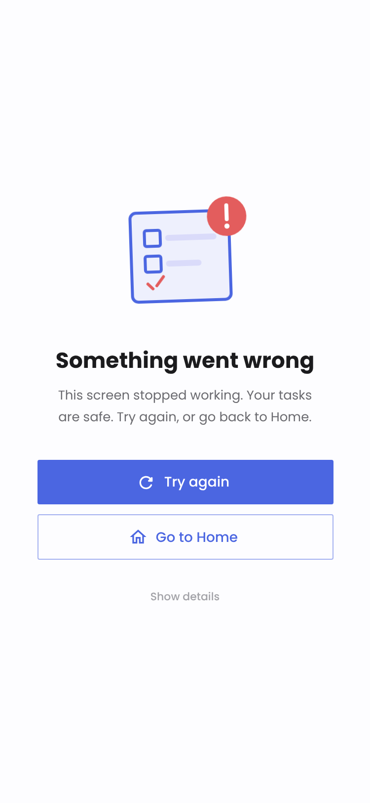 |

| Onboarding | Home | Task Details | Add Task |
|---|---|---|---|
|  |  |  | 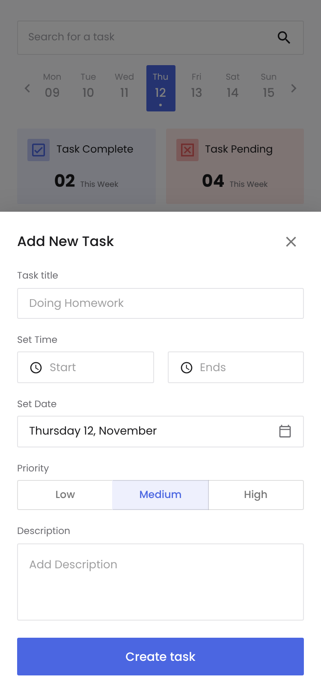 |

| Form checks | Time picker | Date picker | Confirm delete |
|---|---|---|---|
| 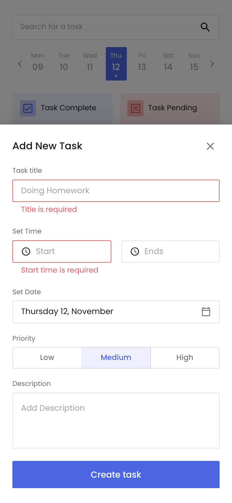 |  | 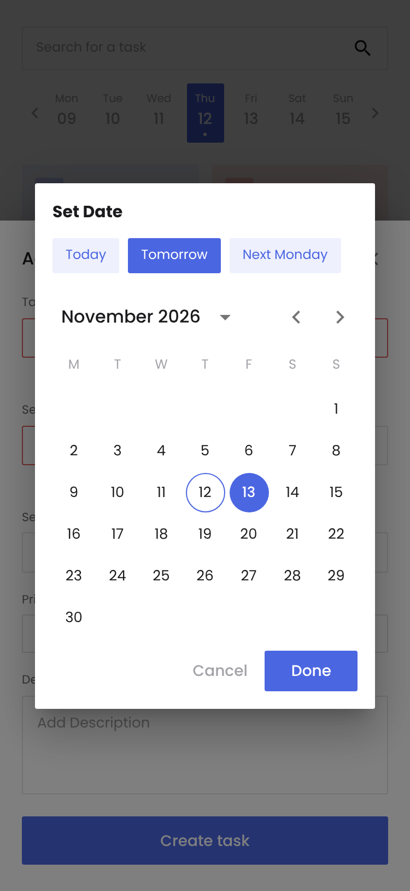 | 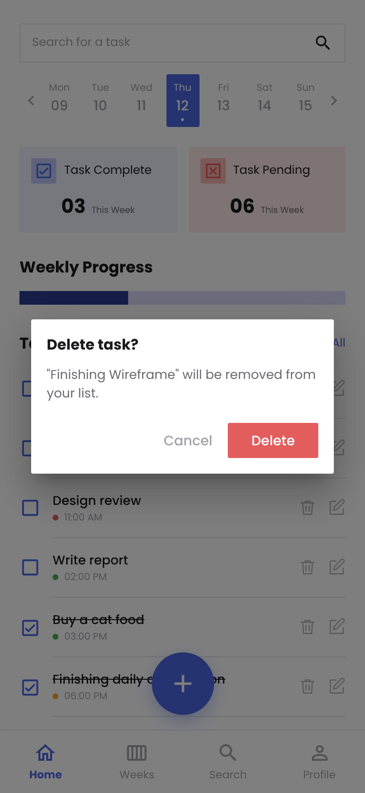 |

| Swipe to delete | All Weeks | Search | Sign In (wrong password) |
|---|---|---|---|
| 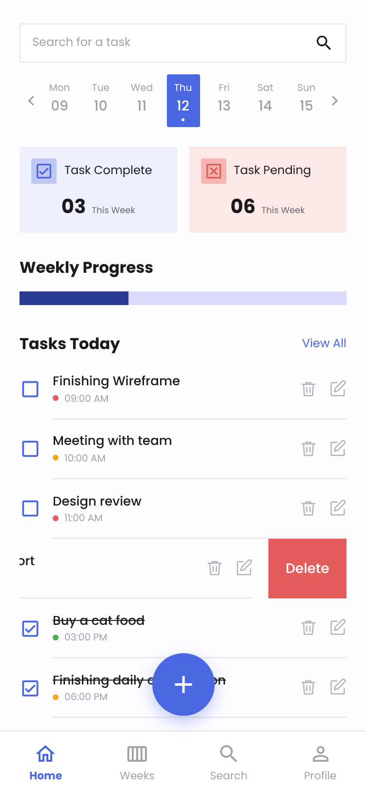 | 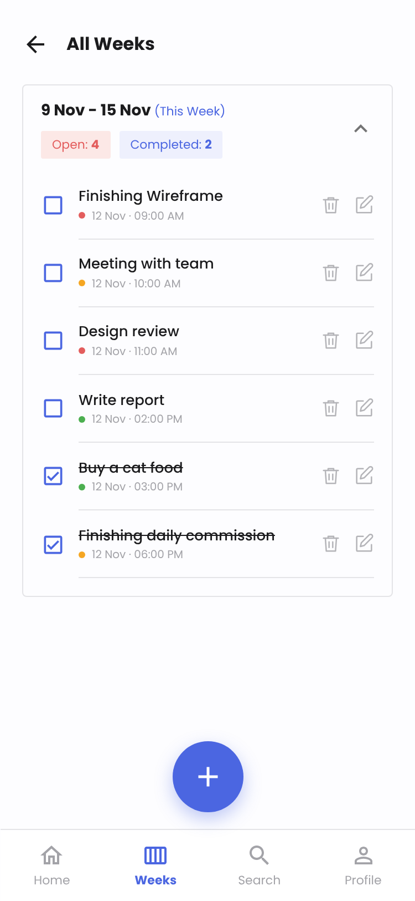 | 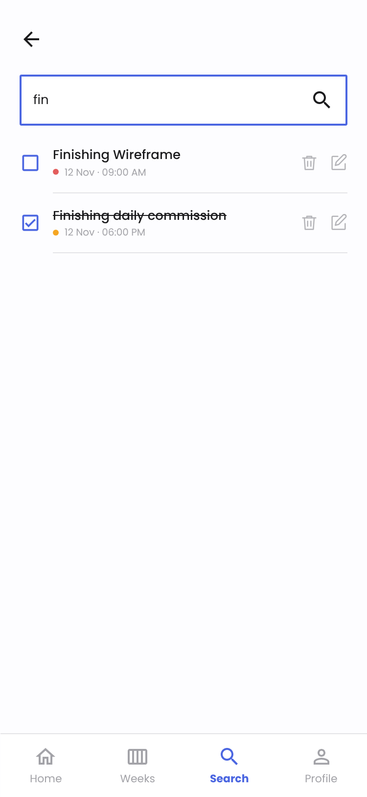 | 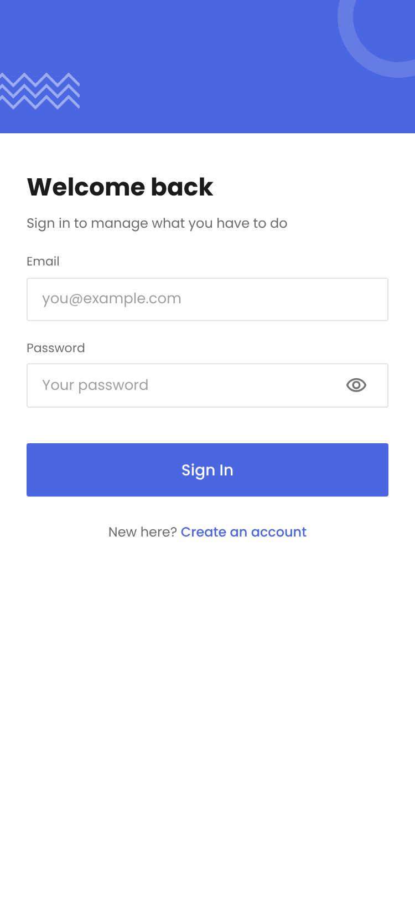 |

| Sign Up checks | Profile | Sign out | Sign In (test account) |
|---|---|---|---|
| 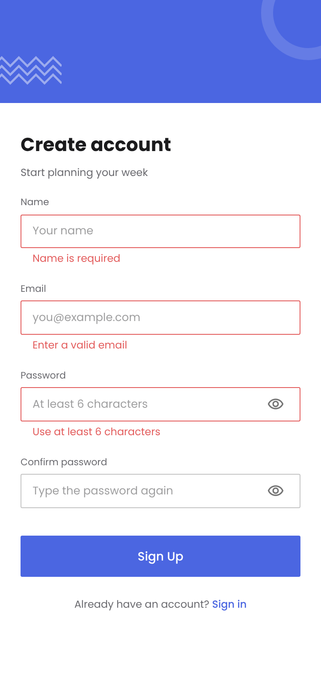 |  | 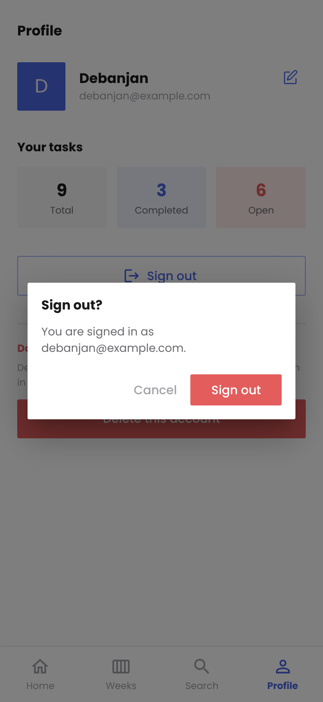 | 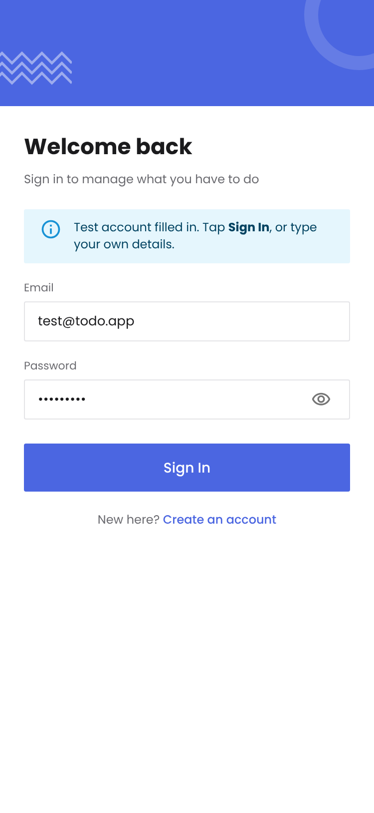 |

| Edit Profile | Delete account confirm |
|---|---|
| 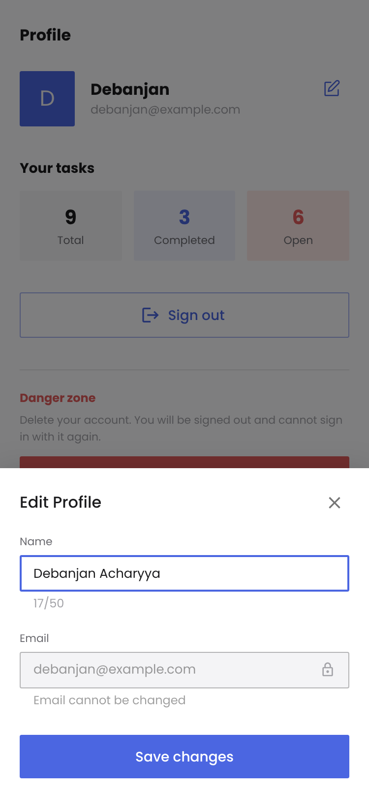 | 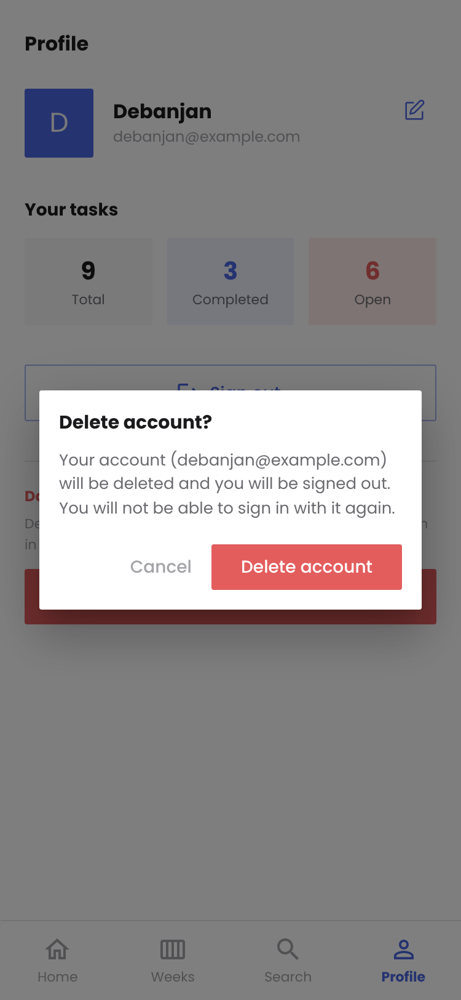 |

---

## 4. Folder structure

```
todo-app/
├── server/                              # Backend (Express API) – see server/README.md
│   ├── src/
│   │   ├── index.js                     # Loads .env, starts the server, connects to MongoDB (with retry), makes the test user
│   │   ├── config/db.js                 # MongoDB connect + retry every 5 s, state, ping
│   │   ├── app.js                       # Express app: middlewares, routes, error handler
│   │   ├── routes/                      # ROUTES: auth, task, health, token, mcp, oauth
│   │   ├── controllers/                 # CONTROLLER: auth, task, health, token, mcp, oauth (HTTP only)
│   │   ├── services/                    # SERVICE: authService.js (hash, JWT, test user), taskService.js, healthService.js, tokenService.js, oauthService.js (one-click Connect)
│   │   ├── data/                        # DATA: userData.js, taskData.js, tokenData.js (the only MongoDB queries)
│   │   ├── models/                      # MODEL: User.js, Task.js, AccessToken.js
│   │   ├── mcp/                         # MCP server: createMcpServer.js (instructions), tools.js (8 task tools)
│   │   ├── middleware/                  # auth.js (requireAuth), errorHandler.js
│   │   └── utils/                       # asyncHandler.js, errors.js (400/401/403/404/409 errors)
│   ├── tests/unit/                      # Vitest unit tests (services, middleware)
│   ├── tests/integration/               # mcp.test.js, oauth.test.js: real app over HTTP (data layer in memory)
│   ├── vitest.config.js
│   ├── .env.example
│   ├── package.json
│   └── pnpm-lock.yaml
│
├── client/                              # Frontend (React + MUI) – see client/README.md
│   ├── src/
│   │   ├── main.jsx                     # Starts React: theme + date pickers + router + AuthProvider
│   │   ├── App.jsx                      # Phone frame → ErrorBoundary → ServerGate → AuthProvider → routes
│   │   ├── routes/
│   │   │   ├── index.jsx                # Signed in? → PrivateRoutes : PublicRoutes
│   │   │   ├── PublicRoutes.jsx         # Onboarding, Sign In, Sign Up
│   │   │   └── PrivateRoutes.jsx        # TaskProvider + Home, Weeks, Search, Profile + bottom nav + shared overlays
│   │   ├── theme.js                     # Figma colors and font (one place)
│   │   ├── api.js                       # All fetch calls + login token (Authorization header)
│   │   ├── context/AuthContext.jsx      # user, signIn, signUp, signOut, session check on start
│   │   ├── context/TaskContext.jsx      # Shared state: tasks, actions, sheet, details, confirm, toast
│   │   ├── utils/dateUtils.js           # Week logic (Monday start, grouping, formatting)
│   │   ├── pages/                       # Onboarding, SignIn, SignUp, Home, Weeks, Search, Profile, OAuthConsent, SomethingWentWrong
│   │   └── components/
│   │       ├── ScreenLayout.jsx         # Fixed header + scrolling list
│   │       ├── BottomNav.jsx, AddFab.jsx # Bottom navigation + floating "+" button
│   │       ├── AuthLayout.jsx           # Shared Sign In / Sign Up layout and fields
│   │       ├── EditProfileDrawer.jsx    # Edit name (email disabled)
│   │       ├── ConnectClaudeDrawer.jsx  # Access tokens + MCP setup snippets
│   │       ├── ErrorBoundary.jsx        # Catches crashes → SomethingWentWrong page
│   │       ├── startup/                 # ServerGate (health check logic), StartupScreen (UI), SplashLogo
│   │       ├── TaskItem.jsx             # One task row (checkbox, swipe, icons)
│   │       ├── TaskDetails.jsx          # Read-only details drawer
│   │       ├── TaskSheet.jsx            # Add / Edit form
│   │       ├── ConfirmDialog.jsx        # "Delete task?" dialog
│   │       ├── WeekStrip.jsx, WeekCard.jsx, SummaryCards.jsx
│   │       ├── TaskSkeleton.jsx, icons.jsx, BackHeader.jsx, MobileFrame.jsx, PickerField.jsx
│   │       └── pickers/                 # TimeSheet, DateSheet, WheelColumn, QuickChips, DialogParts
│   ├── tests/                           # setup.js, renderWithProviders.jsx, unit/*.test.js(x)
│   ├── index.html                       # Title, description, favicon, Open Graph / X preview tags
│   ├── public/
│   │   ├── _redirects                   # Netlify: send all routes to index.html
│   │   ├── favicon.svg, favicon-32.png  # Browser tab icon
│   │   ├── apple-touch-icon.png, icon-192.png, icon-512.png  # Home-screen icons
│   │   ├── site.webmanifest             # App name, icons, theme color ("Add to Home Screen")
│   │   └── og-image.jpg                 # 1200×630 link-preview image (63 KB)
│   ├── .env.example
│   ├── package.json
│   └── pnpm-lock.yaml
│
├── docs/screenshots/                    # Screenshots used in this README
├── CLAUDE.md                            # Guide for AI coding agents (layers, rules, commands)
├── AGENTS.md                            # Points to CLAUDE.md
└── README.md
```

---

## 5. Data model

`server/src/models/Task.js`

| Field | Type | Rule |
|---|---|---|
| `user` | ObjectId → User | **Required**. Owner of the task (set by the server from the token) |
| `title` | String | **Required**, trimmed |
| `description` | String | Optional |
| `dateTime` | Date | **Required**. Date + start time in one value |
| `endTime` | String `"HH:mm"` | Optional ("Ends" in Figma) |
| `priority` | `Low` / `Medium` / `High` | Default `Medium` |
| `status` | `In Progress` / `Completed` | Default `In Progress` |
| `isDeleted` | Boolean | Default `false`. `true` = soft deleted (hidden) |
| `deletedAt` | Date | Time of the soft delete, else `null` |
| `createdAt`, `updatedAt` | Date | Added by Mongoose (`timestamps`) |

- **Soft delete:** `DELETE /tasks/:id` only sets `isDeleted: true` and `deletedAt`. The data layer adds `{ isDeleted: false }` to every query, so deleted tasks are hidden but stay in MongoDB. The service ignores `isDeleted`, `deletedAt`, `_id` and the timestamps in request bodies.
**User** (`server/src/models/User.js`): `name` (required), `email` (required, unique, lowercase, format check), `password` (bcrypt **hash** only, never returned by queries), `isTestUser` (a unique partial index allows only **one** test user per database), `isDeleted` / `deletedAt` (**soft delete**), timestamps. Email is unique **among active accounts** (partial index), so a deleted account's email can sign up again as a new account.

- **Why is date + start time one field?** Sorting and grouping by week need only one value, and MongoDB sorts dates natively.

---

## 6. API

| Where | Base URL |
|---|---|
| **Live** (Render) | `https://todo-list-api-1n6q.onrender.com/api` |
| Local (`pnpm dev` in `server`) | `http://localhost:5000/api` |

Quick check: [`/api/health`](https://todo-list-api-1n6q.onrender.com/api/health)

**Status (public)**

| Method | Endpoint | Response |
|---|---|---|
| GET | `/health` | `200` all OK / `503` something down. `{ status, version, uptimeSeconds, time, checks: { api, database (latencyMs), auth, testUser } }` |

**Auth (public)**

| Method | Endpoint | Body | Response |
|---|---|---|---|
| POST | `/auth/signup` | `{ name, email, password }` | `201 { token, user }` · 400 · 409 email used |
| POST | `/auth/signin` | `{ email, password }` | `200 { token, user }` · 401 wrong email or password |
| GET | `/auth/me` | – (token) | `200 { user }` · 401 |
| PUT | `/auth/me` | `{ name }` (token) | `200 { user }` · 400 empty / too long. **Email cannot change** (ignored) |
| DELETE | `/auth/me` | – (token) | `200 { message }` · **soft delete** · 403 for the test account |
| GET | `/auth/test-user` | – | `200 { email, password }` of the demo account · 404 when `TEST_USER_ENABLED=false` |

**Tasks (private)**: send `Authorization: Bearer <token>`. Without a valid token → `401`. Each user sees and changes only their own tasks.

| Method | Endpoint | Body | Response |
|---|---|---|---|
| GET | `/tasks` | – | The user's tasks, earliest first |
| GET | `/tasks?search=word` | – | Tasks with `word` in the title or description |
| GET | `/tasks/:id` | – | One task |
| POST | `/tasks` | `{ title, dateTime, description?, endTime?, priority? }` | `201` + new task |
| PUT | `/tasks/:id` | Any fields, e.g. `{ status: "Completed" }` | Updated task |
| DELETE | `/tasks/:id` | – | `{ message, id }` (**soft delete**) |

**Access tokens (private, app session only)**: personal access tokens for AI clients. These endpoints need the **sign-in JWT**; a personal access token gets `403`, so an AI client cannot make more tokens.

| Method | Endpoint | Body | Response |
|---|---|---|---|
| GET | `/tokens` | – | `[{ id, name, prefix, lastUsedAt, createdAt }]` (never the full token) |
| POST | `/tokens` | `{ name }` (1–40 characters) | `201 { id, name, prefix, ..., token }` · the **only** time the full token is returned · 400 after 10 tokens |
| DELETE | `/tokens/:id` | – | `{ message }` · **soft delete**: the token stops working at once |

**OAuth (for Claude "Connect")**, not under `/api`: `GET /.well-known/oauth-protected-resource`, `GET /.well-known/oauth-authorization-server`, `POST /oauth/register`, `GET /oauth/authorize` (→ consent page), `POST /oauth/token`. The consent page uses `GET /api/oauth/authorize/info` and `POST /api/oauth/authorize` (session JWT only).

**MCP**: `POST /mcp` (not under `/api`), see [AI access (MCP)](#ai-access-mcp).

Errors: `400` invalid data · `401` not signed in (or account deleted) · `403` not allowed · `404` unknown, deleted or another user's task · `409` email already used · `500` server error. All errors are `{ "message": "..." }`.

```bash
# Use the live API (or API=http://localhost:5000/api when running locally)
API=https://todo-list-api-1n6q.onrender.com/api

# 1. sign in with the test account (or /auth/signup for a new one) and copy the token
curl -X POST $API/auth/signin -H "Content-Type: application/json" \
  -d '{"email":"test@todo.app","password":"Test@1234"}'

# 2. use the token
curl -X POST $API/tasks -H "Content-Type: application/json" \
  -H "Authorization: Bearer <token>" \
  -d '{"title":"Finishing Wireframe","dateTime":"2026-11-12T09:00","priority":"High"}'

# 3. list your tasks
curl $API/tasks -H "Authorization: Bearer <token>"
```

---

## 7. How the code works

### Server: controller → service → data

```
Request ─▶ routes ─▶ controller ─▶ service ─▶ data ─▶ model ─▶ MongoDB
                     (req / res)   (rules)    (queries) (schema)
Any error ─▶ middleware/errorHandler.js ─▶ { message } + status (400 / 404 / 500)
```

| Layer | File | Job |
|---|---|---|
| Route | `routes/taskRoutes.js` | URL + method → controller function |
| Controller | `controllers/taskController.js` | Reads `req`, calls the service, sends `res`. No database code, no try/catch (`asyncHandler`). |
| Service | `services/taskService.js` | Business rules: id check, search regex, protected fields, 404. No `req`/`res`, no queries. |
| Data | `data/taskData.js` | The only file that queries MongoDB. Adds the soft-delete filter. |
| Model | `models/Task.js` | Fields, types, required rules, defaults |

Each file has one job. The service can be tested without HTTP. If the database changes, only the data file changes.

### Startup, server status and the test user

```
Server start ─▶ app.listen()  (answers at once, even if MongoDB is down)
             └▶ connectWithRetry()  (every 5 s until connected) ─▶ ensureTestUser()

GET /api/health ─▶ healthService: api ✓ · database: state + ping (2 s timeout) · auth: JWT_SECRET · testUser: count = 1
                ─▶ 200 { status: "ok" } or 503 { status: "error" } with a message per check

App start ─▶ ServerGate ─▶ already checked in this session? ─▶ yes: show the app at once
                       └▶ no: StartupScreen rows ─▶ ok: "All systems ready" → save flag → fade → app
                                                 └▶ error: reason + countdown → check again
```

- **One test user per database:** `ensureTestUser()` does an **upsert** on `{ isTestUser: true }`, so it always updates the same document, and the password is reset to the known value on each start. A unique partial index on `isTestUser` makes a second test user impossible, even with two servers. If a normal account already has the test email, the server logs a warning and does not touch that account.
- **Credentials:** `TEST_USER_EMAIL` / `TEST_USER_PASSWORD` (defaults `test@todo.app` / `Test@1234`). `GET /api/auth/test-user` gives them to the Sign In screen. **Set `TEST_USER_ENABLED=false` in production**, because this endpoint shows the password on purpose.
- **Error boundary:** `ErrorBoundary` (a React class component) catches render errors in any screen and shows `SomethingWentWrong`. **Try again** renders the screens again; **Go to Home** reloads the app.

### Authentication

```
Sign Up / Sign In ─▶ authService: bcrypt hash / compare ─▶ JWT { id } signed with JWT_SECRET (7 days)
Client saves the token (localStorage) ─▶ api.js adds "Authorization: Bearer <token>" to every request
/api/tasks ─▶ middleware/auth.js verifies the token ─▶ req.userId ─▶ every task query has { user: req.userId }
```

**Client routing:** `routes/index.jsx` reads `useAuth()`. While a saved token is checked (`GET /auth/me`) it shows a spinner. Then it renders **`PrivateRoutes`** (signed in) or **`PublicRoutes`** (signed out). Private pages are not mounted at all for a signed-out user, and any unknown URL redirects (`/signin` or `/home`). If the server answers `401` (for example, an expired token), `api.js` calls `signOut()` and the user returns to Sign In.

**Profile and account delete:** `PUT /auth/me` changes only the name. `DELETE /auth/me` marks the account `isDeleted: true` (nothing is removed; the user's tasks stay, hidden). `requireAuth` checks on every private request that the account still exists, so an old token of a deleted account gets `401` at once. The test account cannot be deleted (`403`), so the demo login always works.

Security notes: passwords are stored only as bcrypt hashes. Sign in gives the same message for an unknown email and a wrong password. The client cannot set `user` on a task. In production, use a long random `JWT_SECRET`. A safer store than localStorage is an httpOnly cookie (a possible improvement).

### Request flow (sequence)

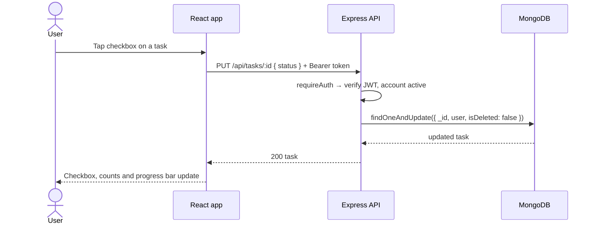

### Client: data flow
```
User taps the checkbox
   → TaskItem: toggleStatus(task)                [component, shows a spinner]
   → TaskContext: api.updateTask(id, { status }) [shared state]
   → fetch PUT /api/tasks/:id                    [api.js]
   → route → controller → service → data         [server]
   → updated task comes back → setTasks(...)     [state]
   → Home, All Weeks and Task Details re-render  [counts + progress bar change]
```

### AI access (MCP)

The API also has an **MCP server** (Model Context Protocol). With it, Claude can work with your tasks in chat: *"What is open this week?"*, *"Add a call with Sam tomorrow at 3 pm, high priority"*, *"Mark the gym task done"*.

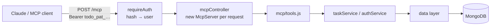

**How to connect (one click, OAuth)**

1. In Claude, open **Settings → Connectors → Add custom connector**.
2. Name: `To-Do List`. MCP server URL: `https://todo-list-api-1n6q.onrender.com/mcp`. Click **Add**, then **Connect**.
3. The To-Do app opens. Sign in if asked, then tap **Allow**. Claude is connected. You copy no token.

Claude Code: `claude mcp add --transport http todo https://todo-list-api-1n6q.onrender.com/mcp`, then type `/mcp` and sign in.

To stop access: **Profile → Connect to Claude → Revoke**.

**With a token (clients without OAuth)**

In **Profile → Connect to Claude → With a token**, type a name and tap **Create**. Copy the token: it is shown **one time**. Then use the snippet from the drawer, for example:

```json
// Claude Desktop: claude_desktop_config.json
{
  "mcpServers": {
    "todo": {
      "command": "npx",
      "args": ["-y", "mcp-remote", "https://todo-list-api-1n6q.onrender.com/mcp",
               "--header", "Authorization: Bearer <your-token>"]
    }
  }
}
```

**OAuth flow (simple version of Retainia's MCP OAuth)**

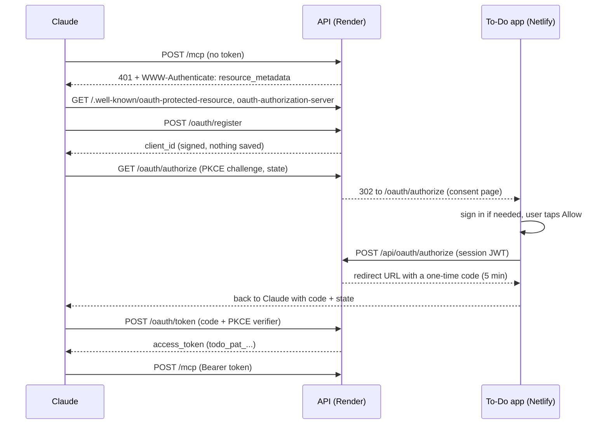

- **No Redis and no new collections.** The client id and the code are JWTs signed with a separate key (`JWT_SECRET + ":oauth"`), so an OAuth JWT can never be used as a sign-in session.
- **Safe redirect URIs only:** `claude.ai`, `claude.com` and `localhost` (add more with `OAUTH_REDIRECT_HOSTS`).
- **PKCE (S256) is required.** A stolen code is useless without the verifier.
- **The access token is a personal access token,** marked "Connected app" in the Profile list. One token per app: connecting again revokes the old one.
- **Only the signed-in app can tap Allow** (session JWT). An access token gets `403`.

**Tools**

| Tool | Does | Type |
|---|---|---|
| `get_profile` | Name and email of the token owner | read |
| `list_tasks` | Tasks in a date range (`from`, `to`) and/or by `status` | read |
| `search_tasks` | Text search in title and description | read |
| `create_task` | New task (`title`, `dateTime`, `endTime?`, `priority?`, `description?`) | write |
| `update_task` | Change any fields of a task | write |
| `complete_task` | Mark Completed (or back to In Progress) | write |
| `delete_task` | Soft delete. Marked **destructive**, so the client asks the user first | write |
| `weekly_summary` | Total, completed, open, completion %, open high-priority and overdue tasks | read |

**Design choices**

- **Same rules as the app.** Each tool calls the same service functions as the REST API, so user scope, validation and soft delete are in one place.
- **Personal access tokens.** Random 32-byte tokens with the prefix `todo_pat_`. The server stores only the **sha256 hash**, plus a short prefix to show in the list. Max 10 tokens per user. `lastUsedAt` is updated on each use. Revoke = soft delete.
- **Least power.** A token can use the task API and `/mcp`, but it **cannot** manage tokens (`403`). Only the signed-in app can.
- **Stateless transport.** Streamable HTTP with JSON answers. A new MCP server is made for each request, so nothing is kept in memory and it works on Render's free plan. `GET /mcp` → `405`.
- **Errors the model can fix.** A `400` / `404` from a service comes back as a tool error (`isError: true`, `"Error: Task not found"`), not a crash.

### Key ideas to explain
0. **Auth state (`AuthContext`) and route groups (`routes/`):** see "Authentication" above. `TaskProvider` lives inside `PrivateRoutes`, so tasks load only after sign in and are cleared on sign out.
1. **One shared state (`TaskContext`):** tasks load once. All pages read the same list. The context also controls the add/edit sheet, the details drawer, the confirm dialog and error messages.
2. **One sheet for add and edit (`TaskSheet`):** `openSheet()` opens an empty form, and `openSheet(task)` opens it with saved values.
3. **Task Details (`TaskDetails`):** the context keeps only the task **id** and finds the task in the list, so the drawer updates at once. Edit closes the drawer first, so two drawers are never open together.
4. **Week logic (`dateUtils.js`):** `startOfWeek()` moves back to Monday. `groupTasksByWeek()` groups by that Monday and counts `open` and `completed`.
5. **Search:** done on the server (regex on title OR description). The UI waits 300 ms after typing stops (debounce), so it sends one request and not one per key.
6. **Pickers (`PickerField` + `pickers/`):** a read-only field shows "Start" or "Friday 14, January". A tap opens a dialog. `WheelColumn` is a scroll list with `scroll-snap`, and the middle row is the value.
7. **Confirm dialog:** `const ok = await confirm({ title, message })` returns a Promise with `true` or `false`, so delete code reads top to bottom.
8. **Loading UI:** `TaskSkeleton` on the first load. Each `TaskItem` has its own `busy` state, so only that row shows a spinner.
9. **Swipe to delete (`TaskItem`):** touch events move the row left (max 80px). A swipe of more than half keeps the red **Delete** button open.
10. **Fixed header, scrolling list (`ScreenLayout`):** the page is `100dvh` tall. The header does not move, and the list below it has `flex: 1; minHeight: 0; overflowY: auto`.
11. **Bottom navigation (`BottomNav`):** the selected tab follows the URL. `ScreenLayout` subtracts the nav height, and `AddFab` floats 16px above it.
12. **Theme (`theme.js`) and icons (`icons.jsx`):** Figma colors, the Poppins font, and thin SVG trash/edit icons, each in one place.

---

## 8. Run locally

**Requirements:** Node.js 18+, pnpm (`npm install -g pnpm`), and MongoDB (local or a free Atlas cluster).

### Backend (terminal 1)
```bash
cd server
cp .env.example .env        # set MONGO_URI and JWT_SECRET (any long random string)
pnpm install
pnpm dev                    # http://localhost:5000
```

### Frontend (terminal 2)
```bash
cd client
cp .env.example .env        # VITE_API_URL=http://localhost:5000/api
pnpm install
pnpm dev                    # http://localhost:5173
```

Open http://localhost:5173 and use the browser's mobile view (DevTools → device toolbar). The startup screen checks the server, then you can sign in with the filled-in **test account** (`test@todo.app` / `Test@1234`) or make your own.

---

## 9. Deploy

### a) Database – MongoDB Atlas
1. Make a free cluster on [mongodb.com/atlas](https://www.mongodb.com/atlas).
2. Add a database user. Under **Network Access**, allow `0.0.0.0/0`.
3. Copy the connection string → `MONGO_URI`.

### b) API – Render
1. **New → Web Service**, then connect the GitHub repo.
2. Root directory: `server`. Build: `npm install -g pnpm@10 && pnpm install --frozen-lockfile --prod`. Pin **pnpm 10**: pnpm 11 ignores the `"pnpm"` field in package.json and refuses packages published less than 1 day ago. Start: `pnpm start`.
3. Environment: `MONGO_URI=...`, `JWT_SECRET=<long random string>`, `CLIENT_URL=<Netlify URL>` (or `*`). For a public demo keep `TEST_USER_ENABLED=true`; for real users set it to `false`.
4. Copy the service URL. Live: `https://todo-list-api-1n6q.onrender.com`.
5. Health check path for Render: `/api/health`.

### c) Frontend – Netlify
1. **Add new site → Import from Git**.
2. Base directory: `client`. Build command: `pnpm build`. Publish directory: `client/dist`.
3. Environment: `VITE_API_URL=https://todo-list-api-1n6q.onrender.com/api`, `NODE_VERSION=22`. Live: `https://todo-list-mern01.netlify.app`.
4. Deploy. `public/_redirects` makes page refresh work on `/home`, `/weeks` and `/search`.

> The free Render plan sleeps after inactivity. The first request can take about 30 seconds.

---

### d) Sharing & SEO (link preview)

When the link is pasted in WhatsApp, Slack, LinkedIn, X or iMessage, it shows a card:


| What | Where | Why |
|---|---|---|
| Title + `description` | `client/index.html` | Text in Google results and in link cards |
| Favicon (SVG + 32 px PNG) | `public/favicon.svg`, `favicon-32.png` | Browser tab and bookmarks |
| `apple-touch-icon` (180 px), 192 / 512 px icons + `site.webmanifest` | `public/` | Home-screen icon on iPhone / Android, app name, blue `theme-color` |
| Open Graph tags (`og:title`, `og:description`, `og:image` 1200×630, `og:url`) | `client/index.html` | The card in WhatsApp, Slack, LinkedIn, Facebook |
| `twitter:card = summary_large_image` | `client/index.html` | The large card on X |

Notes:
- `og:image` and `og:url` must be **full URLs** (`https://todo-list-mern01.netlify.app/...`). If the site name changes, update them in `client/index.html`.
- The image is a **JPEG under 100 KB**: WhatsApp skips preview images that are too big (about 300 KB or more).
- Apps **cache** previews. To see a new one, share the link with a new ending (for example `?v=2`), or refresh it with LinkedIn's Post Inspector. To check all platforms at once: opengraph.xyz.
- `_redirects` does not hide these files: Netlify serves real files (like `/og-image.jpg`) before the `/* → /index.html` rule.

## 10. Tests

### Automated tests (Vitest) – 106 tests

```bash
cd server && pnpm test     # 55 tests (40 unit + 15 integration)
cd client && pnpm test     # 51 tests
pnpm test:watch            # re-run on every save (either folder)
```

A **unit test** checks one piece alone. Its dependencies are replaced with **mocks** (`vi.mock`), so no database, no server and no browser are needed, and the tests run in a few seconds.

| Folder | File | What it checks |
|---|---|---|
| server | `taskService.test.js` (11) | search builds a safe, case-insensitive regex; bad / unknown id → 404; protected fields (`user`, `isDeleted`, …) are removed; delete is a soft delete |
| server | `authService.test.js` (16) | sign-up rules, 409 for a used email, bcrypt hash stored (never the password); same 401 message for a wrong password and an unknown email; tokens; edit name (email ignored); delete account (403 for the test account); one test user, env settings |
| server | `healthService.test.js` (6) | `ok` / `error` for database up, down, ping failure, missing `JWT_SECRET`; test user `warn` / `off` |
| server | `middleware.test.js` (7) | `requireAuth` (no token, valid token, deleted account); `errorHandler` maps errors to 400 / 404 / 409 / 500 and hides 500 details |
| server | `integration/mcp.test.js` (9) | the **real Express app** with the official **MCP SDK client** over HTTP (only the data layer is in memory): token shown once and stored as a hash; a token cannot manage tokens (403); revoke stops it at once; `/mcp` needs a token; 8 tools listed; create → list by week → complete → search → weekly summary → soft delete; tool errors; user A's tasks are never seen or changed by user B |
| server | `integration/oauth.test.js` (6) | full one-click Connect like Claude: 401 + `WWW-Authenticate`, metadata, register → authorize (302 to the consent page) → Allow → token (form post) → MCP works; reconnect replaces the old token; wrong PKCE verifier, another client, untrusted redirect URI refused; only the signed-in app can approve |
| client | `dateUtils.test.js` (12) | Monday-start weeks (Sunday is the END), 7 days, grouping and open / completed counts, formatting |
| client | `api.test.js` (8) | `Authorization` header, JSON body, URL encoding, error status, 401 → sign out only when a token was sent, health on 503 |
| client | `SignIn.test.jsx` (5) | test account filled in, field errors, error clears on typing, trimmed email, server error shown |
| client | `SignUp.test.jsx` (5) | name, email, 6-character password, passwords match, server "already exists" |
| client | `ServerGate.test.jsx` (4) | all ready → app + session flag; skipped when already checked; server unreachable → countdown; database down → retries by itself (fake timers) |
| client | `ErrorBoundary.test.jsx` (3) | crash → "Something went wrong", details, **Try again** recovers |
| client | `WeekStrip.test.jsx` (3) | Mon–Sun days, tap selects a day, arrows move one week |
| client | `ConnectClaudeDrawer.test.jsx` (6) | one-click setup first (URL, Claude Code command, no token); token list shows only the prefix or "Connected app"; new token shown once and put in the snippet; empty name blocked; revoke only after confirm |
| client | `OAuthConsent.test.jsx` (5) | shows who asks and the account; **Allow** sends the same request and goes back to Claude; **Cancel** sends `access_denied`; bad link shows an error; signed out → request kept → Sign In |

**Do the tests catch bugs?** Yes. Two bugs were added on purpose to check this. When the server stopped removing the `user` field, 2 tests failed. When weeks started on Sunday, 9 client tests failed. With the correct code, all tests pass.

### Manual and end-to-end checks done during development

**Backend**
- An HTTP test through the real routes → controller → service → data → error handler (only the database model is stubbed): create 201, missing title 400, bad id 404, search, status update, soft delete (hidden, still in the database), and a second delete 404.
- Schema checks: a missing title or date is rejected, an invalid priority is rejected, and defaults are set.

**Auth (real server app with an in-memory database stub + real client)**
- Private pages and `/api/tasks` without a token → Sign In page / `401`.
- Sign Up: empty form errors; success → Home; same email again → "already exists" (409).
- Password stored as a bcrypt hash; never returned.
- Sign In: wrong password → "Email or password is wrong" (401); right → Home with the user's tasks.
- Reload keeps the session; Sign out (confirm) clears the token and returns to Sign In.
- A second user sees none of the first user's tasks and gets `404` for them (get, edit, delete).
- Bottom nav: Home, Weeks, Search, Profile tabs open the right pages.

**Profile and account delete**
- Edit Profile: email field disabled; name saved, shown at once and after reload; an email sent to the API is ignored; empty / 51-char names → 400.
- Delete account: Cancel keeps it; confirm → signed out, account still in the database with `isDeleted: true`, tasks kept; old token → 401; sign in refused; the same email can sign up again as a new account.
- The test account: Delete button disabled; API returns 403.

**Startup, health and test user**
- `/api/health`: database down → 503 with "MongoDB is disconnected"; all up → 200 with the ping time.
- Three server starts → still **one** test user, password reset each time; a normal account with the test email is left alone.
- Server off → startup screen says it cannot reach the server, with a countdown; server on but database down → shows "Database: Down"; after the fix → "All systems ready" → app.
- Sign In is filled with the test account; signing in works and Profile shows **TEST ACCOUNT**.
- A forced crash (bad user data) → "Something went wrong" page; **Go to Home** recovers.

**Frontend (375×812 phone)**
- Onboarding → Home; add a task (form errors, then success).
- Tap a task → Task Details → Mark Completed → Edit → Delete.
- Checkbox toggles the status; the counts and the progress bar update.
- Time and date pickers save the correct value.
- Confirm dialog: Cancel keeps the task, Delete removes it (icon, swipe, and sheet).
- Skeletons and spinners show with a slow API.
- Only the list scrolls on Home, All Weeks and Search.
- No console errors.

---

## 11. Presentation guide (5–7 minutes)

1. **Problem (30s):** a to-do app with weekly progress, built from a Figma design.
2. **Demo (2–3 min):** Onboarding → Sign Up → add a task (pickers) → tap it (details) → complete it (counts change) → edit → swipe to delete (confirm) → search → View All weeks.
3. **Architecture (1 min):** the server layers and the client data flow in section 7.
4. **Code tour (2 min):**
   - `taskController.js` → `taskService.js` → `taskData.js` (one job per file)
   - `TaskContext.jsx` (shared state + `confirm()`)
   - `dateUtils.js` (Monday-based weeks)
   - `TaskItem.jsx` (swipe + per-row spinner)
   - `routes/index.jsx` + `middleware/auth.js` (who can see what)
5. **Choices (30s):** soft delete (no data loss), layered server, MUI, Context instead of Redux (small app), and one date field for easy sorting.
6. **Next steps:** restore deleted tasks, password reset, reminders, offline mode.

---

## 12. Possible improvements
- httpOnly cookie for the token, refresh tokens, and a "forgot password" flow.
- Rate limiting on sign in.
- A "Recently deleted" page that uses the soft-delete data to restore tasks.
- Pagination or server-side week grouping for very large task lists.
- Integration tests with a real MongoDB (Supertest + mongodb-memory-server) and end-to-end tests (Playwright), run in CI (GitHub Actions).
- MCP OAuth: short-lived access tokens with refresh tokens, single-use codes (store used code ids), and read-only access.
